
<a href="README.md">Русский</a> · <b>English</b>

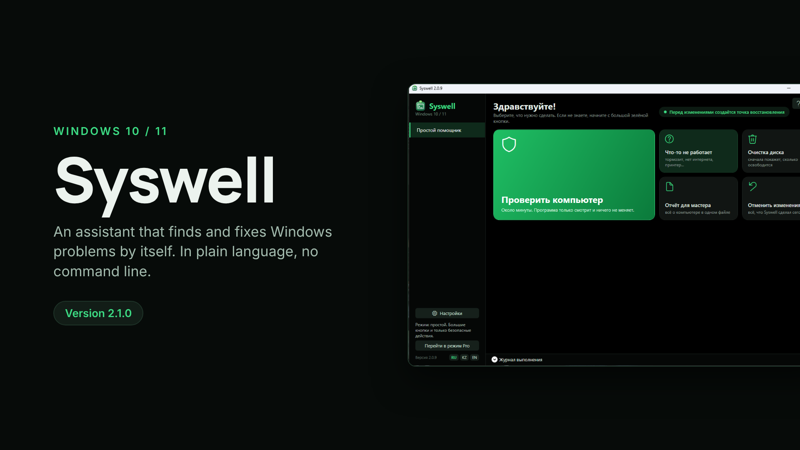

<h1 align="center">Syswell</h1>

An assistant that finds and fixes Windows 10 / 11 problems by itself. Plain language, no command line.

  
  

  
  
  

## Download

| File | What it is |
|---|---|
| [**setup_syswell.exe**](https://raw.githubusercontent.com/rossofrost98-lgtm/syswell/main/release/setup_syswell.exe) | Installs on the PC with shortcuts; uninstall from “Apps”. |
| [**Syswell.exe**](https://raw.githubusercontent.com/rossofrost98-lgtm/syswell/main/release/Syswell.exe) | Runs without installing, for example from a USB stick. |

> If Windows shows the blue “Windows protected your PC” window (SmartScreen), click **“More info”**, then **“Run anyway”**. Windows does this for any new program without a paid code-signing certificate; you only need to do it once.

## Highlights

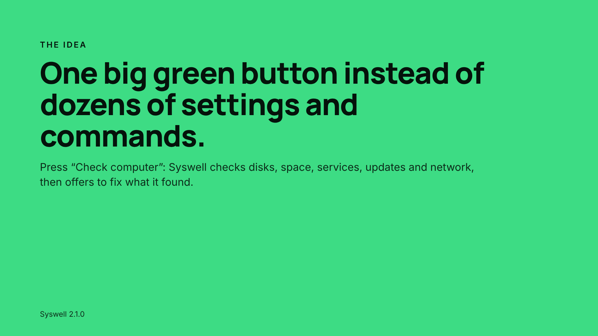
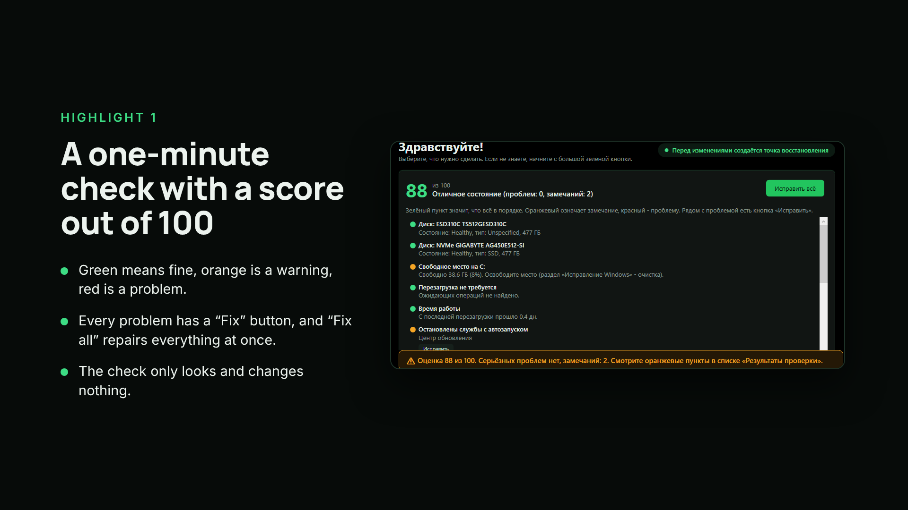
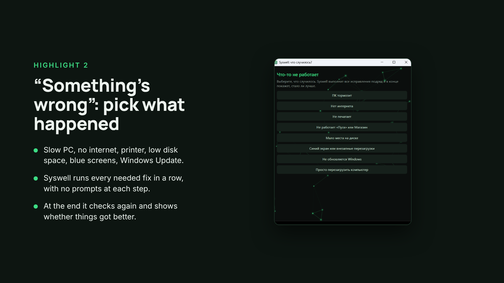
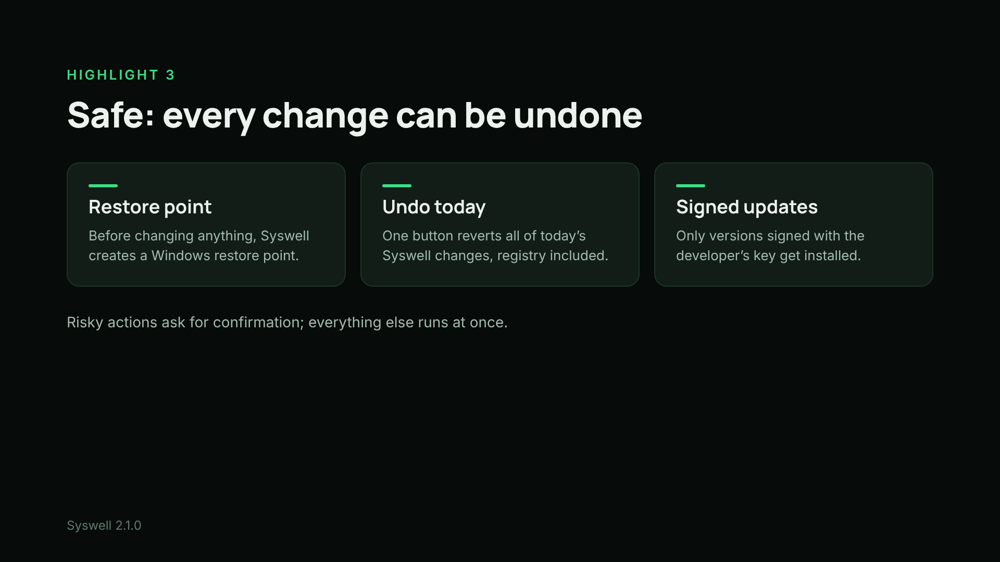
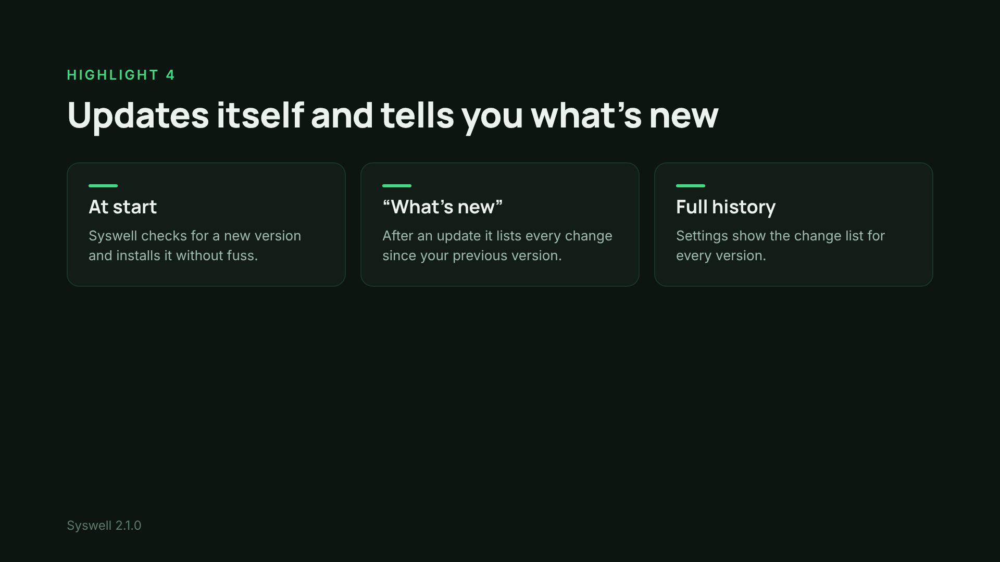
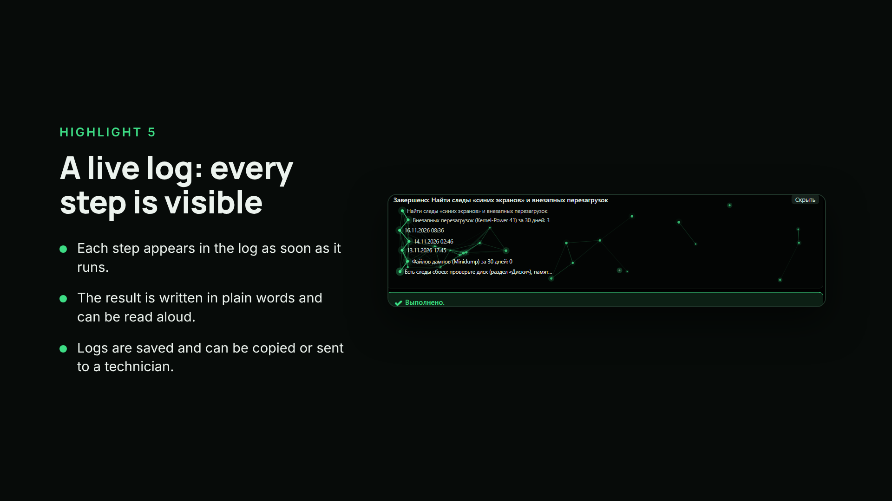
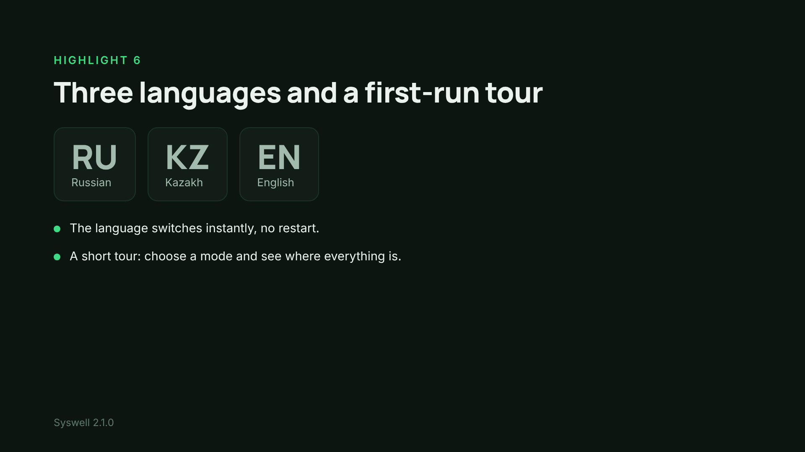
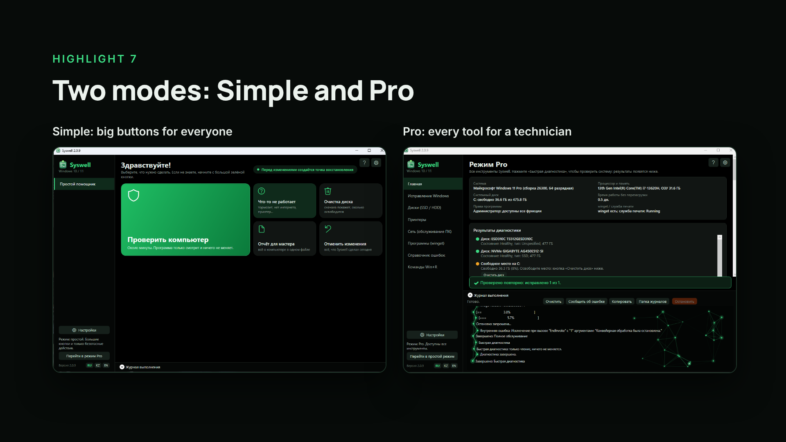
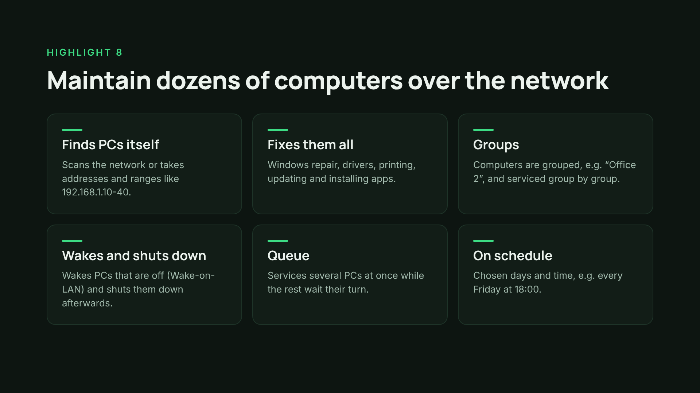
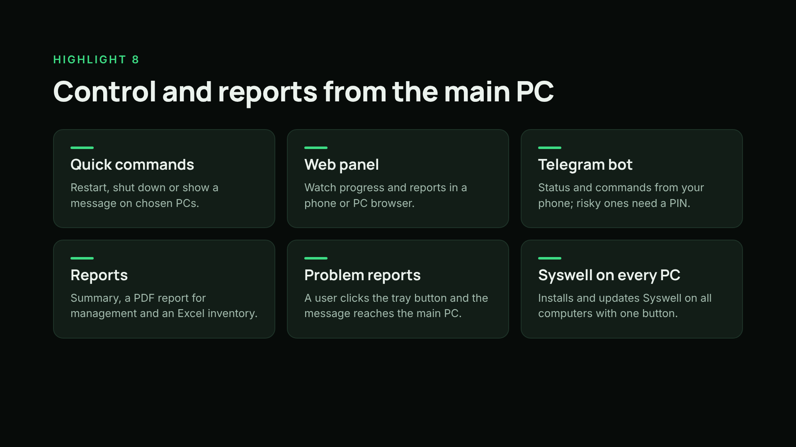

## Everything else

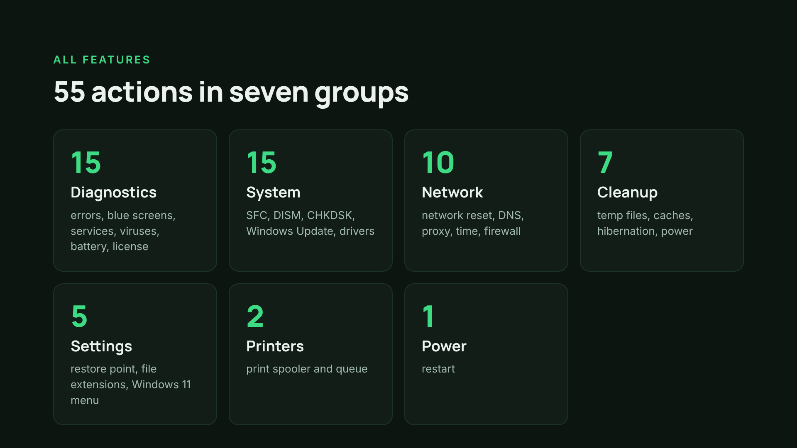
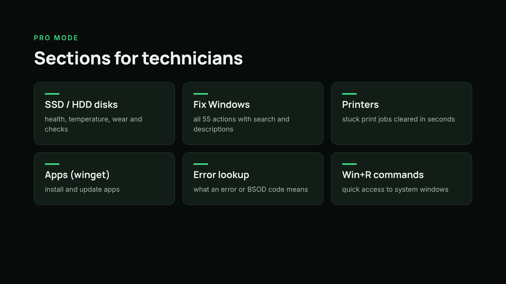
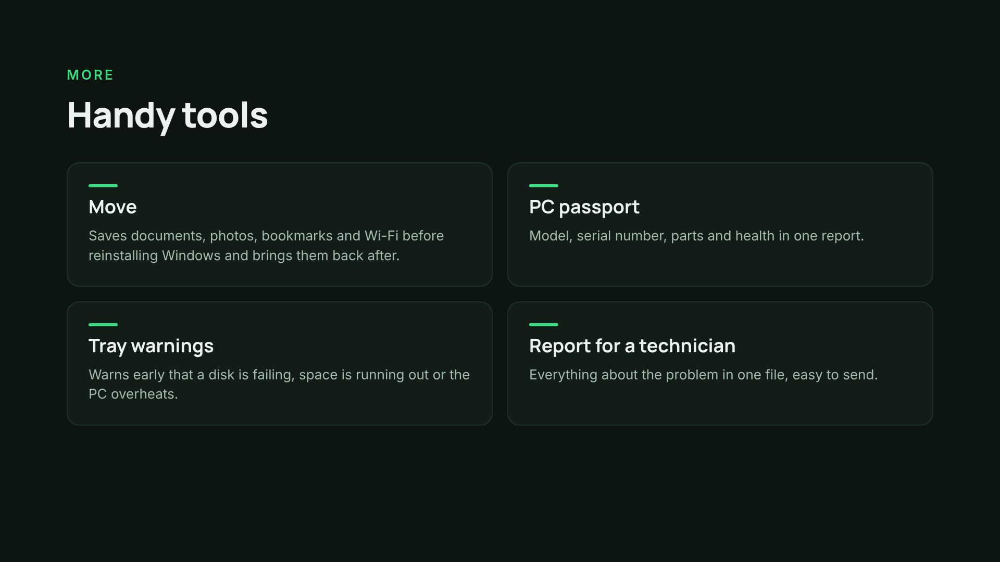
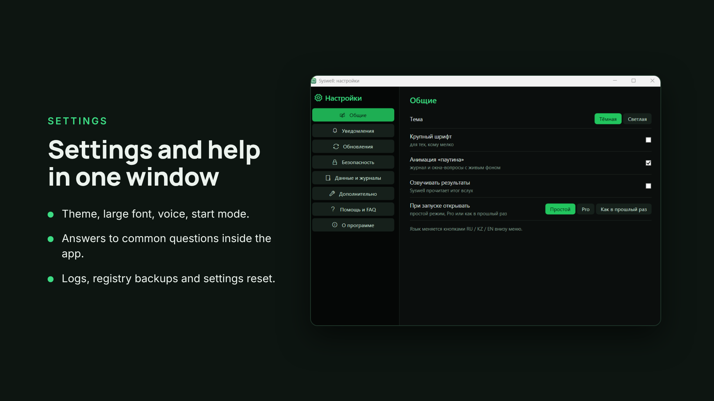
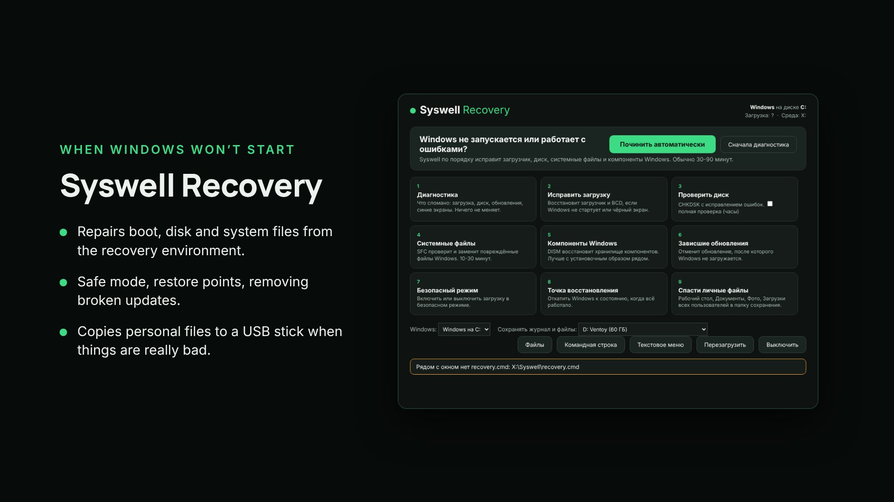
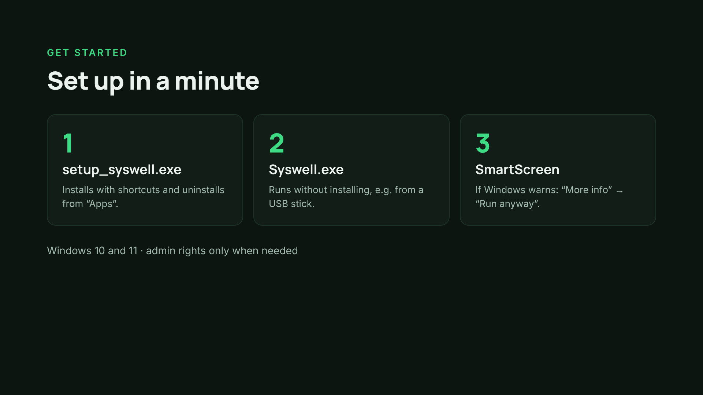

The screenshots show the Russian interface; switch to English with the EN button at the bottom of the menu.

## Updates

Syswell checks for updates at start (the `release/` folder) and installs only versions signed with the developer's key. After an update, “What's new” lists every change since your previous version.

## Author

Author: [rossofrost98@gmail.com](mailto:rossofrost98@gmail.com)

Questions and ideas are welcome by email.
