
<b>Русский</b> · <a href="README.en.md">English</a>

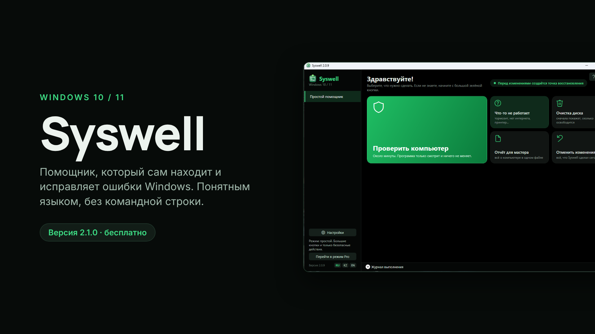

<h1 align="center">Syswell</h1>

Помощник, который сам находит и исправляет ошибки Windows 10 / 11. Понятным языком, без командной строки.

  
  

  
  
  

## Скачать

| Файл | Для чего |
|---|---|
| [**setup_syswell.exe**](https://raw.githubusercontent.com/rossofrost98-lgtm/syswell/main/release/setup_syswell.exe) | Установка на ПК: ярлыки и удаление через «Приложения». |
| [**Syswell.exe**](https://raw.githubusercontent.com/rossofrost98-lgtm/syswell/main/release/Syswell.exe) | Запуск без установки, например с флешки. |

> Если Windows покажет синее окно «Windows защитила ваш компьютер» (SmartScreen), нажмите **«Подробнее»**, затем **«Выполнить в любом случае»**. Так Windows встречает любую новую программу без платной подписи кода, это нужно сделать один раз.

## Главные фишки

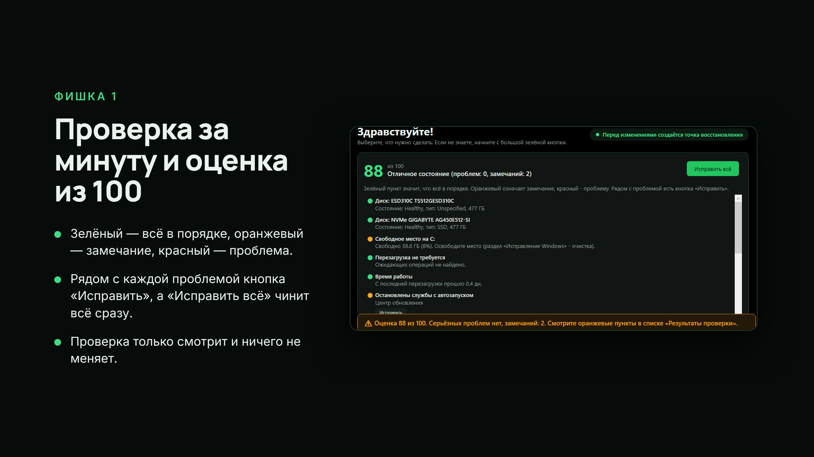
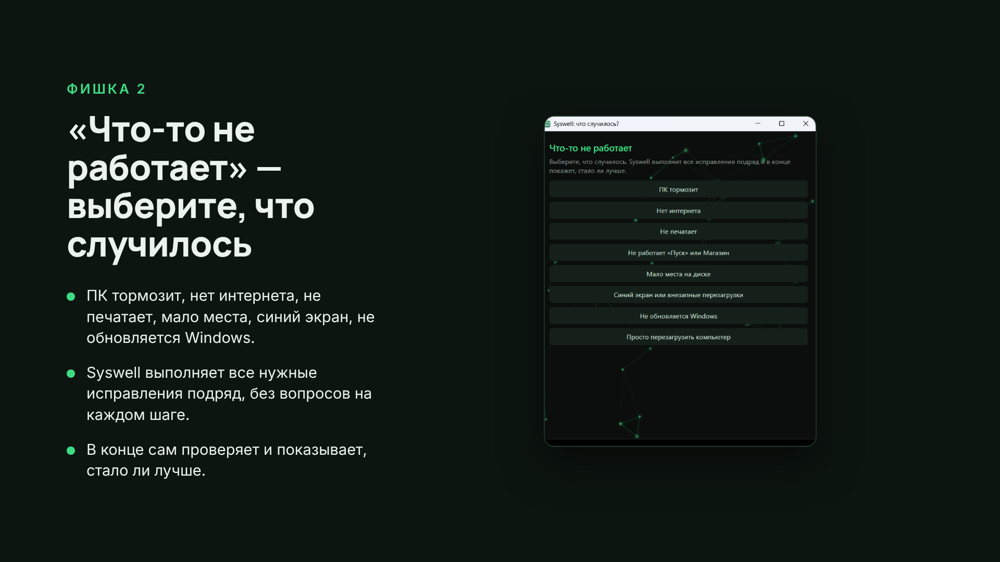
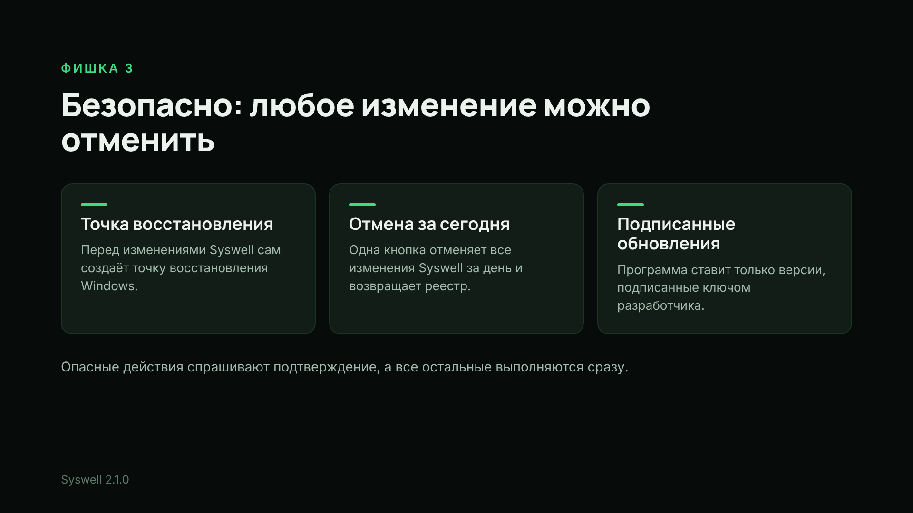
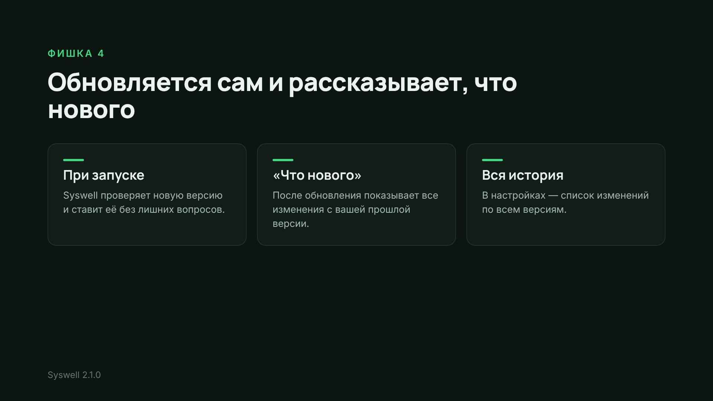
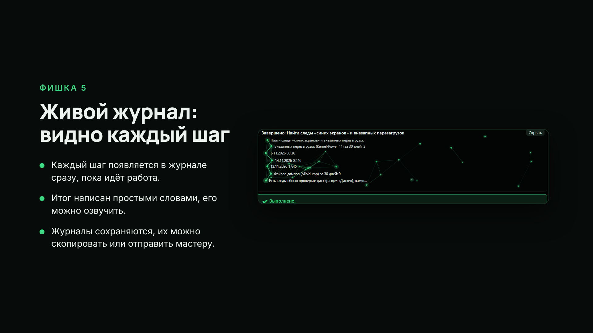
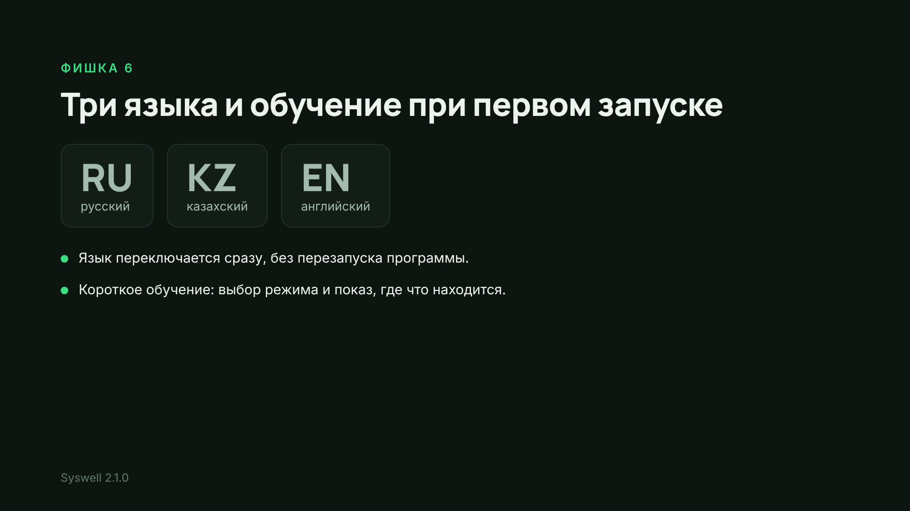
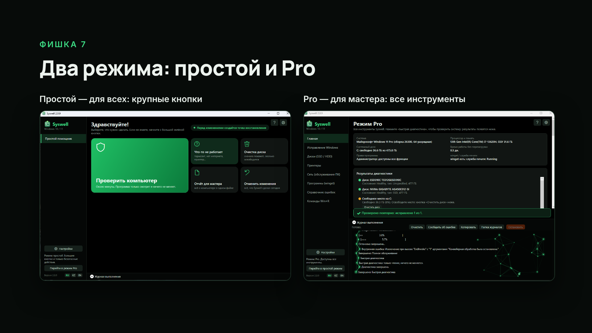
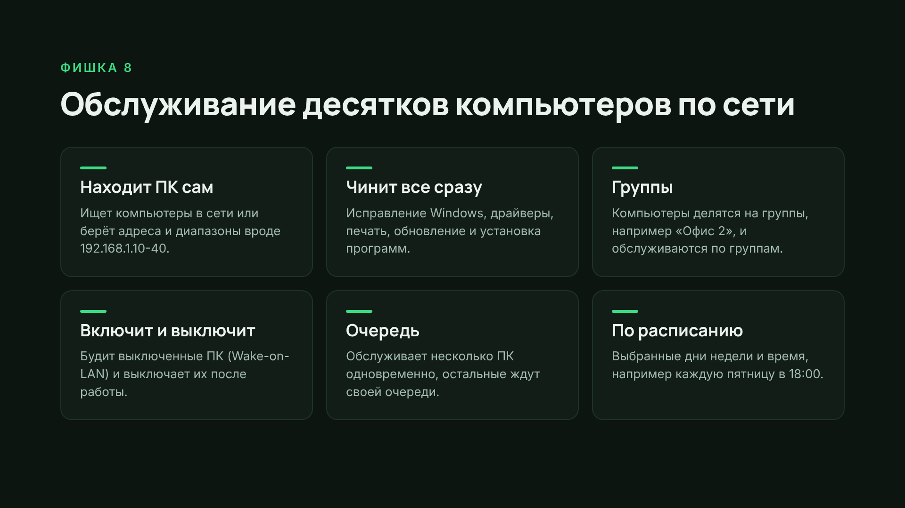
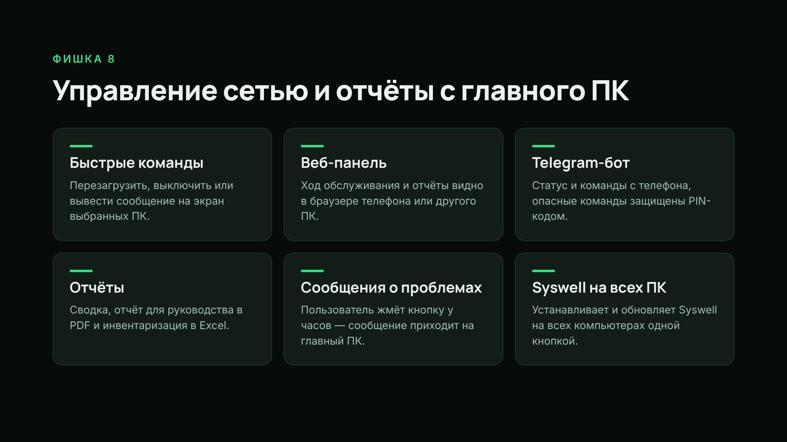

## Остальные функции

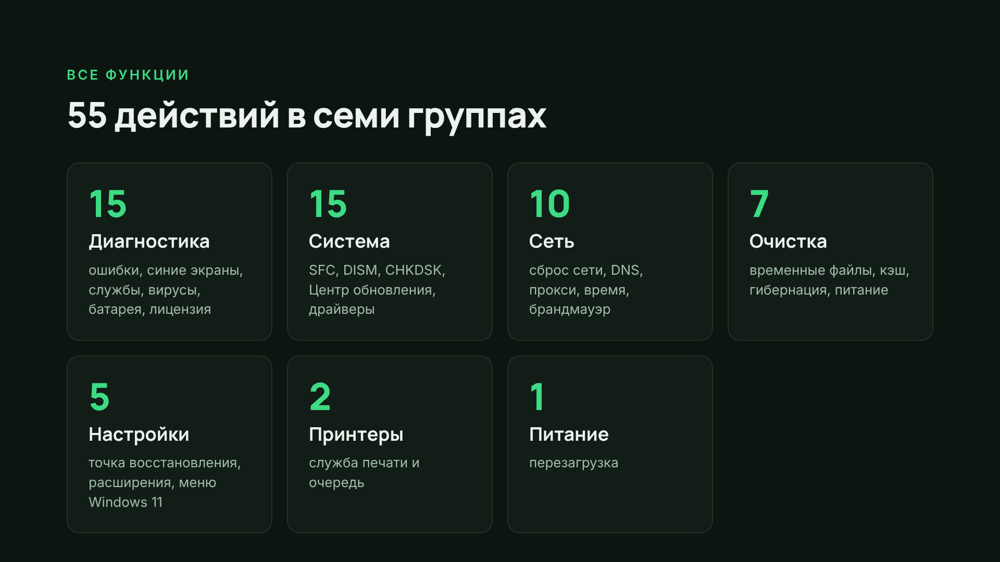
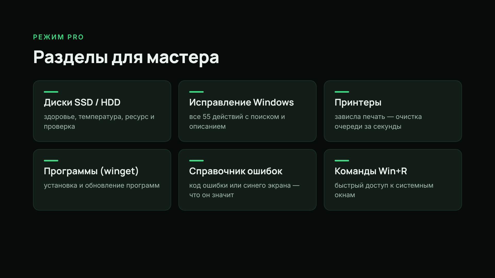
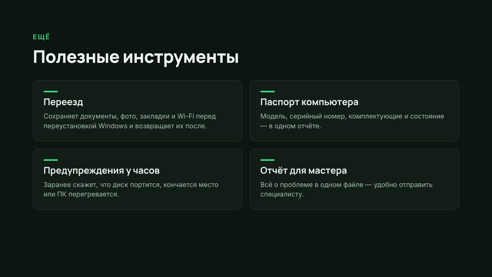
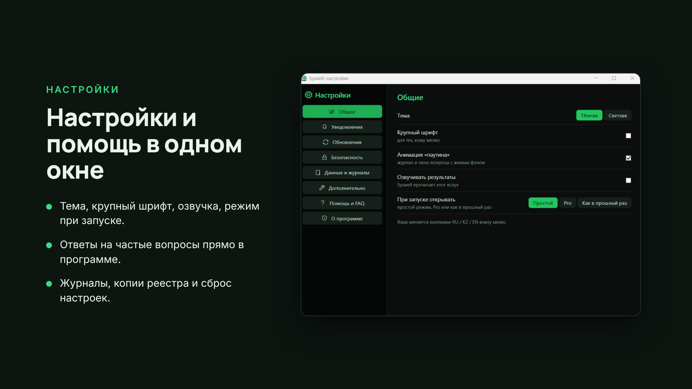
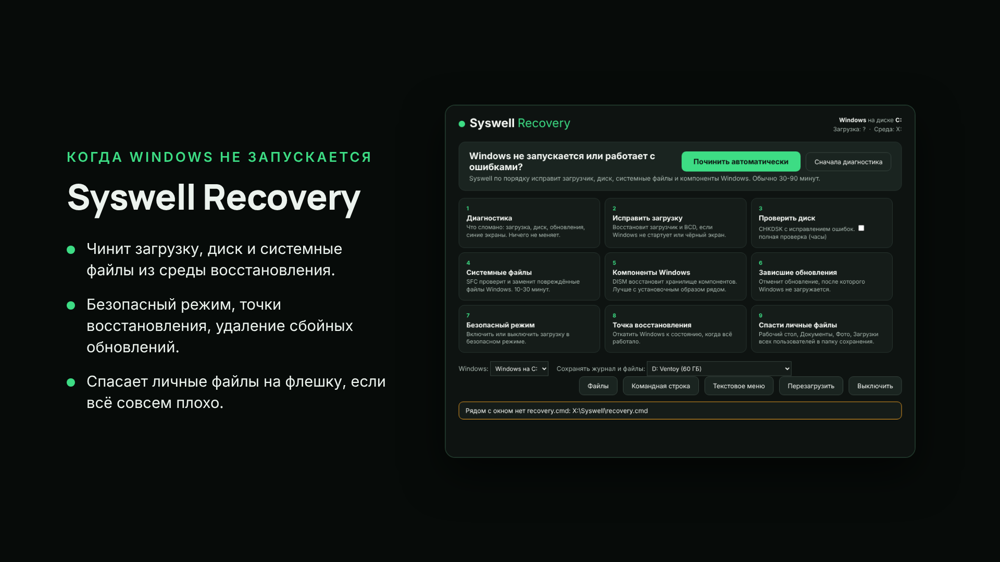
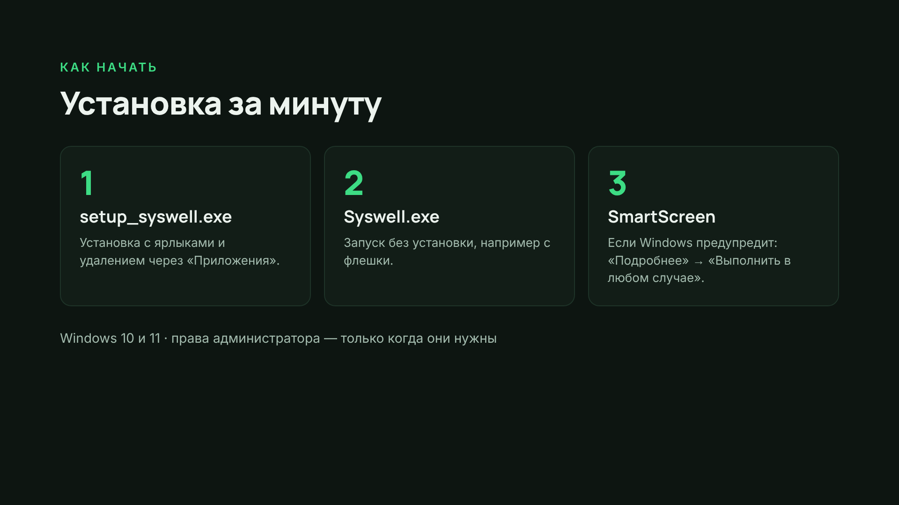

## Обновления

Syswell сам проверяет обновления при запуске (папка `release/`) и ставит только версии, подписанные ключом разработчика. После обновления окно «Что нового» показывает все изменения с вашей прошлой версии.

## Автор

Автор: [rossofrost98@gmail.com](mailto:rossofrost98@gmail.com)

Вопросы и предложения пишите на почту.
